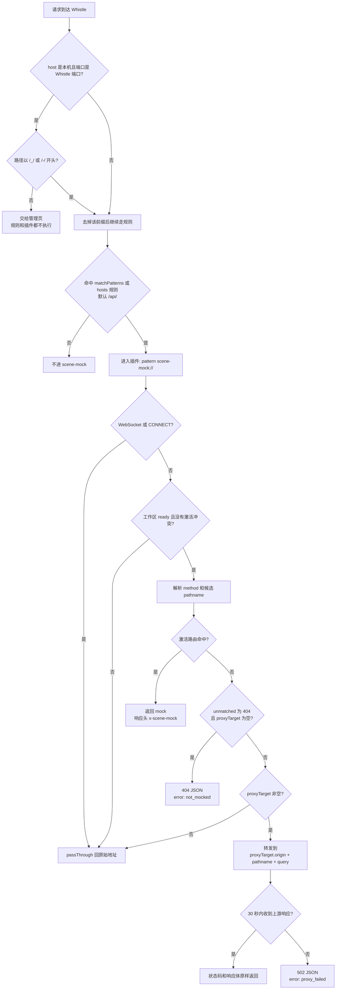
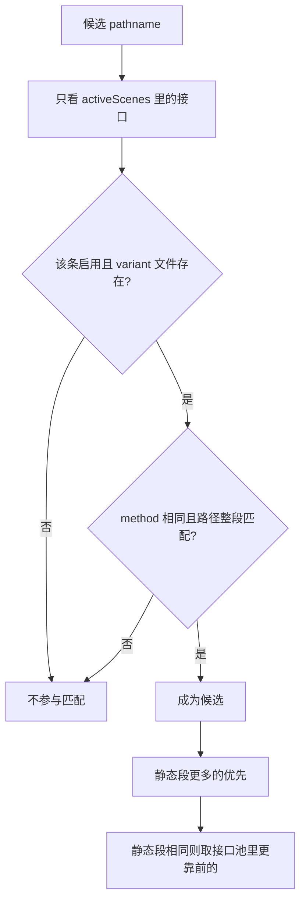

# whistle.scene-mock

把 mock 数据从 Whistle Values 里拆出来，用「接口池 + Scene」管理。切换场景只改激活集合，不丢 JSON、不改用户 Rules。

## 能做什么

- 接口池集中注册 `method + URL`（支持 `:param`）
- Scene 组合接口与返回值；同一接口多份 variant，互不覆盖
- 多 Scene 并行激活；接口重合时整组二选一
- 命中 mock 直接返回；未命中默认回源，或打到 `proxyTarget`
- 管理面板写同一套 `mocks/` 文件，保存后热加载

## 开发环境（热更新）

先打开 **Whistle.app**，再开两个终端，都在项目根目录：

```sh
npm i

# 终端 1：编译 watch（改 src / web 后写出 dist）
npm run dev

# 终端 2：挂到 Whistle，编译产物变化后自动重载插件
npm run watch
```

`npm run watch` 即 `lack watch web/dist`。插件会出现在 Plugins 列表（名为 `scene-mock`），`console.log` 会打到终端 2。

改完后点插件顶栏「刷新」加载新 UI（`mocks/` 仍通过 SSE 热更新，无需整页刷新）。

```sh
npm test
npm run build
```

## 使用

1. 在 Whistle Plugins 打开 **scene-mock**
2. 配置页绑定工作区：填业务仓库根目录，或本仓库的 `fixtures` / `fixtures/mocks`
3. 若还没有 `mocks/`，点「初始化骨架」
4. 插件会按 `matchPatterns`（默认 `/api/`）写入 `rules.txt`：`/api/ scene-mock://`
5. 录入接口池 → 建 Scene → 打开激活开关
6. 业务 https 请求需在 Whistle 开启 HTTPS 抓包

示例数据在 `fixtures/mocks/`（正常下单 / 空数据联调 / 下单异常流）。

## 请求怎么命中

业务请求通过代理进入 Whistle，URL 的 host 保持真实上游。插件按 `matchPatterns`（默认 `/api/`）写入 `rules.txt`，形如 `/api/ scene-mock://`。只有进了规则引擎的请求才会交给插件。

直接请求 `http://localhost:<Whistle端口>/api/...` 时，host 是本机且端口是 Whistle 自己的端口，Whistle 把它交给管理页，插件规则不执行。要强制这种地址进规则，路径写成 `/_/api/...` 或 `/-/api/...`，Whistle 去掉该前缀后再匹配。

`config.json` 的 `hosts` 是可扩展数组，一行一个 host 或完整 URL，和 `matchPatterns` 叠加后各写一条规则。例如：

```json
"hosts": [
  "http://localhost:8889",
  "http://microloan-microcredit-test-c.jhjj.spider.test"
]
```

对应规则是 `localhost:8889 scene-mock://` 和 `microloan-microcredit-test-c.jhjj.spider.test scene-mock://`。其中 `localhost:8889` 若正好是 Whistle 自己的端口，请求仍进管理页，这条规则匹配不到。



### 怎样算命中一条路由

只看当前 `activeScenes`。一条接口要同时满足：Scene 里该条已启用、`data` 指向的 variant 文件存在、method 相同、路径整段匹配（`:param` 只匹配一段）。多条都能配上时，静态段更多的优先；静态段相同则取 `apis.json` 里更靠前的。



method 优先用原始请求里非 GET、非 HEAD 的方法。Whistle 把方法报成 GET，但 body 是 JSON 或表单时，按 POST 匹配。

路径从 `fullUrl`、`originalReq.fullUrl`、`x-whistle-full-url`、`relativeUrl` 等字段收集。短协议 `scene-mock://api/v1/couponPack/sale` 还原为 `/api/v1/couponPack/sale`，第一段 `api` 不当成 host；带真实 host 的 `scene-mock://microloan.example/api/v1/couponPack/sale` 只保留 `/api/...`。

### 未命中之后

| 配置 | 行为 |
| --- | --- |
| `proxyTarget` 为空，`unmatched` 为 `passthrough`（默认） | `passThrough`，回到原始 URL |
| `proxyTarget` 非空 | 打到该 origin，保留 pathname 和 query |
| `unmatched` 为 `404`，且 `proxyTarget` 为空 | 插件返回 404，`error: not_mocked` |

`proxyTarget` 非空时，插件用 `req.request` 把请求交回 Whistle，并带上插件标记，避免再次命中 `/api/ scene-mock://`。工作区未 ready，或激活 Scene 正在冲突时，HTTP 请求直接 `passThrough`，不读 mock，也不走 `proxyTarget`。

## 数据目录

```
mocks/
├── apis.json
├── config.json          # proxyTarget / unmatched / hosts / activeScenes / matchPatterns
├── scenes/<scene-id>.json
└── data/<api-id>/<variant>.json
```

建议不要把个人的 `activeScenes` 提交进主干。
